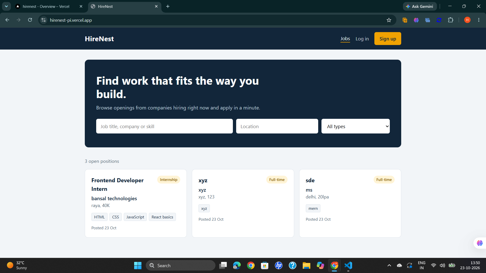
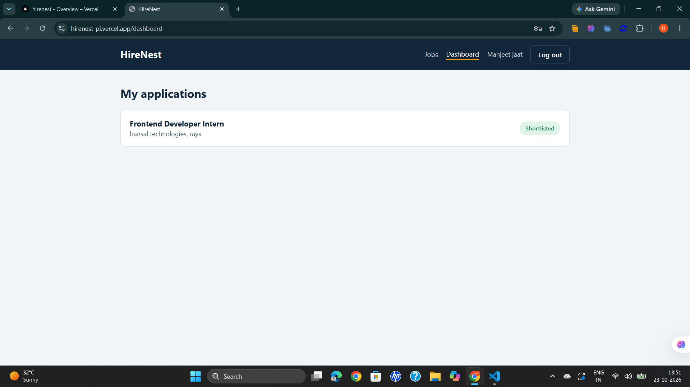
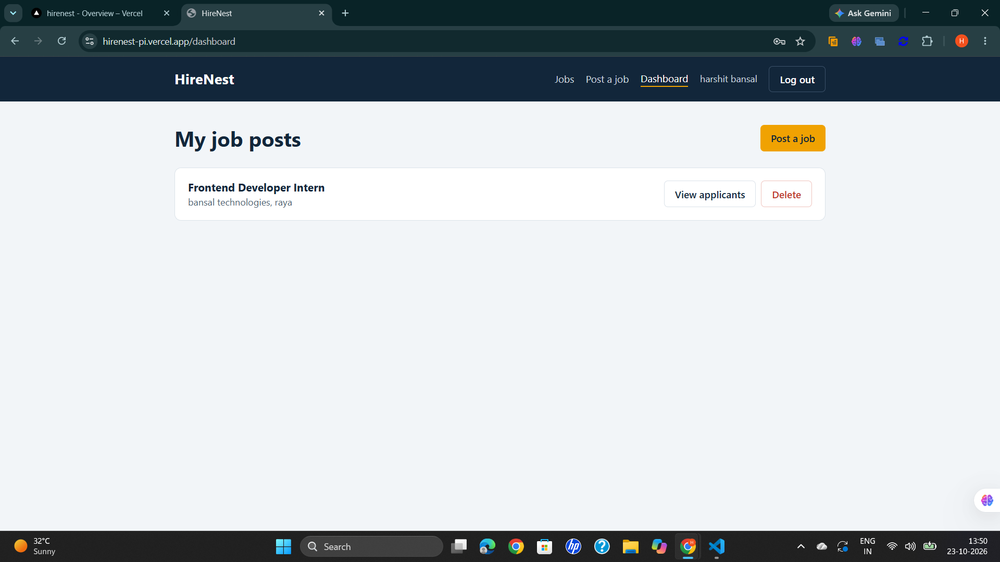

# HireNest

HireNest is a full-stack job portal built using the MERN stack. Employers can post jobs and manage applicants, while job seekers can browse openings, apply with a cover letter, and track their application status.

I built this project to practice developing a complete full-stack application, including authentication, role-based access, database integration, REST APIs, and deployment.

## Live Demo

- **Frontend:** [HireNest Live]
https://hirenest-pi.vercel.app/
- **Backend API:** https://hirenest-evtf.onrender.com/api/jobs

**Note:** The backend is hosted on Render's free plan and may sleep after inactivity. The first request can take around a minute to respond.

## Features

### Job Seeker

- Search jobs by title, company, or skill.
- Filter jobs by location and job type.
- Apply for jobs with a cover letter, with one application per job.
- Track application status from the dashboard.

### Employer

- Create and delete job postings.
- View applicants for posted jobs.
- Update application status to Pending, Shortlisted, or Rejected.

## Tech Stack

- **Frontend:** React, Vite, React Router, Axios
- **Backend:** Node.js, Express.js
- **Database:** MongoDB Atlas, Mongoose
- **Authentication:** JSON Web Tokens (JWT)
- **Password Security:** bcryptjs
- **Deployment:** Vercel (frontend) and Render (backend)

## Running Locally

### Prerequisites

- Node.js and npm
- MongoDB installed locally or a MongoDB Atlas database

### 1. Clone the repository

```bash
git clone https://github.com/harshit-1407/HireNest.git
cd HireNest
```

### 2. Set up the backend

```bash
cd server
npm install
```

Create a `.env` file inside the `server` directory:

```env
PORT=5000
MONGO_URI=mongodb://127.0.0.1:27017/HireNest
JWT_SECRET=your_long_random_secret
```

Use your own secure JWT secret. Keep `.env` out of Git.

Start the backend:

```bash
npm run dev
```

### 3. Set up the frontend

Open a second terminal from the project root:

```bash
cd client
npm install
npm run dev
```

Open [http://localhost:5173](http://localhost:5173) in your browser.

For local development, the frontend uses the Vite proxy configured in `client/vite.config.js`. The production frontend uses the `VITE_API_URL` environment variable to connect to the deployed backend.

Create an employer account and a job seeker account to test the complete workflow.

## Project Structure

```text
HireNest/
├── client/   React frontend, pages, components, and auth context
└── server/   Express API, routes, Mongoose models, and auth middleware
```
## Screenshots

### Home Page


### Job Details


### Employer Dashboard


## Future Improvements

- Resume upload for applicants
- Editing existing job postings
- Pagination on the jobs page
- Email notifications when application status changes

## Author

**Harshit Bansal**

B.Tech Computer Science and Engineering

[GitHub Profile](https://github.com/harshit-1407)